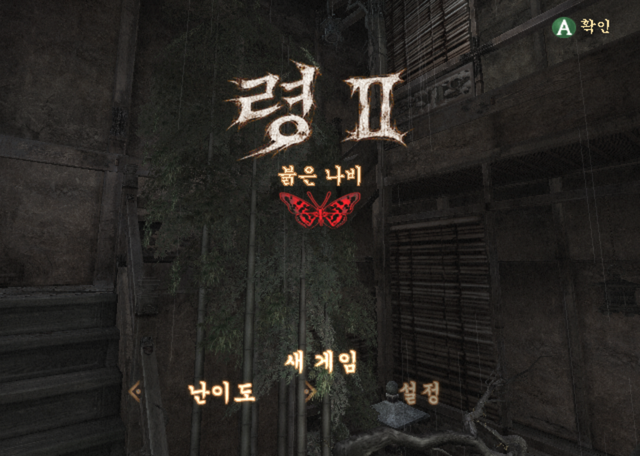
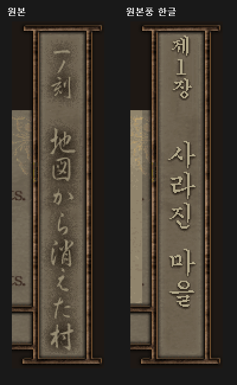
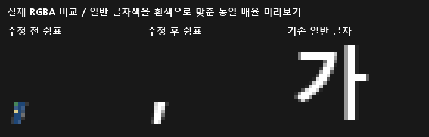

# XBOX 령 II: 붉은 나비 한국어 패치 v0.8

오리지널 Xbox **Fatal Frame II: Crimson Butterfly 일본판**의 비공식 한국어 패치입니다.
쌍둥이 자매 미오와 마유가 지도에서 사라진 마을에 들어가, 사영기로 원혼과 의식의 비밀을 추적하는 공포 게임입니다.
타이틀·메뉴·대사·문서·기존 영상 자막을 한국어로 옮기고 글자 잘림·정렬·잔상과 가독성을 개선합니다.

**코리아 로컬라이즈 GiKakNo**

**[v0.8 Windows EXE 패처 다운로드](https://github.com/OldManCraveGuitars-bit/XBOX-Fatal-Frame-II-Crimson-Butterfly-Kr/releases/tag/v0.8)** · [수정 내역](CHANGELOG.md) · [오류 제보](https://github.com/OldManCraveGuitars-bit/XBOX-Fatal-Frame-II-Crimson-Butterfly-Kr/issues)

**영상 자막과 엔딩 크레딧은 `설정 → 자막 표시 → 켜기`로 설정해야 표시됩니다.** 원본 자막 기본값은 끄기입니다.
v0.8은 **공개 시험판**입니다. 홍보영상 3편의 추가 자막, 전편 수동 대조·진행·저장/불러오기·전체 음성 동기는 검증이 남아 있습니다.

## 적용 방법

1. 릴리스에서 `XBOX-Fatal-Frame-II-Crimson-Butterfly-Kr-v0.8-Windows-Patcher.zip`을 받아 압축을 풉니다.
2. `XBOX-Fatal-Frame-II-Crimson-Butterfly-Kr-v0.8-Patcher.exe`를 실행합니다.
3. 아래 SHA-256과 일치하는 **패치하지 않은 일본판 원본 ISO**를 선택합니다.
4. 새 ISO의 저장 위치를 지정하고 **한국어 ISO 만들기**를 누릅니다.
5. 완료와 전체 해시 검사 통과를 확인한 뒤 생성된 ISO를 사용합니다.
6. 게임 설정에서 **자막 표시를 켜기**로 바꿉니다.

Windows 64비트용이며 Python 설치는 필요하지 않습니다. 차분과 디코더는 EXE에 들어 있습니다.
출력 폴더에는 **3GB 이상**의 여유 공간이 필요합니다. 원본 ISO와 기존 출력 파일은 덮어쓰지 않습니다.
이전 v0.75 한글 ISO나 다른 지역판에는 적용할 수 없습니다. 대상 Title ID는 `5443000A`입니다.

## v0.8 변경 내용

- **XBE 원본 유지:** `default.xbe`의 코드·글자 폭 표·자막 기본값·매체 설정을 포함한 모든 바이트가 일본판 원본과 같습니다.
- 원본 글자 처리 방식에 맞춰 반각 공백을 **10px**, 한글 글자 진행 폭을 **24px**로 유지하고 문구와 이미지 배치를 조정했습니다.
- 설정 상단 `취소 후 돌아가기 / 기본값 복원 / 확인` 안내를 원래 조각 경계에 맞춰 다시 조판했습니다.
- 선택 칸·메모·버튼 설명·괄호·좌우 화살표와 글꼴 경계를 점검했습니다. 수정 글자는 목표 크기로 새로 그립니다.
- 장 제목 13곳을 원본 계열의 옅은 금색·궁서체·부드러운 갈색 음영으로 다시 만들고 음영을 강화했습니다.
- 번역 재검수에서 문장·용어·조사·수치 표현을 보정하고 원본 글리프를 대조해 OCR 오독을 수정했습니다.
- 요청한 구두점은 일반 쉼표 **`,`**로 통일했습니다. 쉼표가 검게 보이던 팔레트 선택 오류를 고쳐 주변 글자색을 따르게 했습니다.
- 생성 글리프 **839개**의 실제 RGB를 검사하고, 같은 문제로 진하게 변색되던 쉼표 포함 **15개**의 색을 바로잡았습니다. 원본 버튼 아이콘 색과 팔레트는 유지합니다.
- 엔딩 3곳의 **기존 마지막 대사 자막 둘째 줄**에 `코리아 로컬라이즈 GiKakNo`를 표시합니다. 원래 대사와 타이밍을 유지하며 약 2.7~3.2초 표시됩니다.

본문 번역 **4,542개**, 의도된 빈 슬롯 **950개**, 수정 이미지 **346개**를 포함합니다.
영상/연출 자막은 등록 표 71개 중 실제 구간이 있는 44개 표의 **원본 253구간**을 사용합니다.
71개 모든 영상에 새 자막을 추가한 구성은 아닙니다.

## 화면과 수정 비교

상단 타이틀과 아래 메뉴·지도는 **이전 빌드에서 확보한 실제 Android GPU 캡처**입니다.
가상 컨트롤러가 없으며 FPS 표시가 있던 상단 48픽셀만 잘랐습니다. v0.8 최종본의 새 기기 캡처는 아닙니다.

| 이전 빌드 메뉴 | 이전 빌드 지도 |
| --- | --- |
|  |  |

아래 두 이미지는 **실제 리소스를 디코딩한 정적 비교 미리보기**입니다. 새 게임 실행 캡처가 아닙니다.

## 지원 원본과 SHA-256

| 항목 | 크기 | SHA-256 |
| --- | ---: | --- |
| 일본판 원본 `Fatal Frame II - Crimson Butterfly (Japan).iso` | 7,825,162,240바이트 | `56a2def60db6ca1d4bfe0525fef72720b87719cca9dfe85d8698afc8c47968e2` |
| v0.8 결과 XISO | 2,200,043,520바이트 | `d1fc3f110924927bec5f148c0a97fc47e08dc7d1e4cf41555bb861a1d0554c3c` |
| 배포 ZIP | 13,257,879바이트 | `9eb020a3f5a1a6a3ae50ff2d8aab33609c6f23394bb19136f194a9ee10ab111b` |
| ZIP 내부 Windows EXE | 13,473,864바이트 | `401a3a472d03a7fe49f408d47555e582ff75c2eebf761aa8c719c619a036b622` |

결과 ISO 안의 `default.xbe` SHA-256은 원본과 같은 `60a20fcc1cbfad2c7178208c0bfda7f62c91188a03ebe08ced06c622e3797ada`입니다.
전체 배포 목록은 [release-manifest.json](release-manifest.json), 다운로드 검사는 릴리스의 `SHA256SUMS.txt`를 확인하십시오.

## 검증 범위와 남은 확인

실제 배포 EXE로 원본 ISO에서 결과 ISO 전체를 다시 만들고 전체 해시를 대조했습니다.
독립적으로 ISO를 다시 열어 **4,157개 파일**의 경로·크기·해시와 원본 XBE 일치를 확인했습니다.
원본 중 **99개 파일**이 변경되며 나머지 **4,058개**는 같습니다.
변경 대상 밖 진행 스크립트·모델·음성·영상·저장 식별 정보는 유지합니다.

메시지 5,492개·포인터 표 85개, 안전한 문자 코드·반각 공백·선택 칸 길이·설명 두 줄 제한,
생성 글리프 839개의 색과 원본 아이콘 보존, 기존 엔딩 자막의 48개 조건을 PC에서 검사했습니다.
이 검사는 전편 플레이나 최신 수정본의 실제 GPU 표시 검증을 대신하지 않습니다.

- **미구현:** `promo_01/02/03.pss` 홍보영상 3편에는 원본 자막 구간이 없고 한국어 자막을 추가하지 않았습니다.
- 크레딧은 마지막 대사와 함께 나옵니다. 스태프롤 끝의 독립 크레딧 카드는 아닙니다.
- 원본 매체 설정 `0x00000202`를 유지합니다. HDD 실행 허용 값 `0x800000FF`로 바꾸는 패치는 포함하지 않습니다.
- 전편 모든 문장과 이미지 속 일본어, 해금·상세 메뉴, 전체 음성 동기·진행·저장/불러오기는 추가 검수가 필요합니다.

[검증 요약](verification/release-checks.json) · [상세 검증 범위](docs/VERIFICATION.md) · [패처 빌드](docs/BUILD.md) · [외부 구성 요소](licenses/THIRD-PARTY.md)

배포물에는 EXE 패처·사용법·체크섬·라이선스를 포함합니다. 게임 ISO와 완전한 원본 게임 파일은 배포하지 않습니다.
이 저장소는 배포용 패처 소스와 설명·화면 자료·검증 요약을 관리합니다. 제작용 텍스트/이미지 편집기는 로컬 제작 프로젝트와 별도입니다.
오류 제보에는 버전, 장면·메뉴, 사용 환경, 화면과 적용 후 ISO SHA-256을 함께 남겨 주세요.
