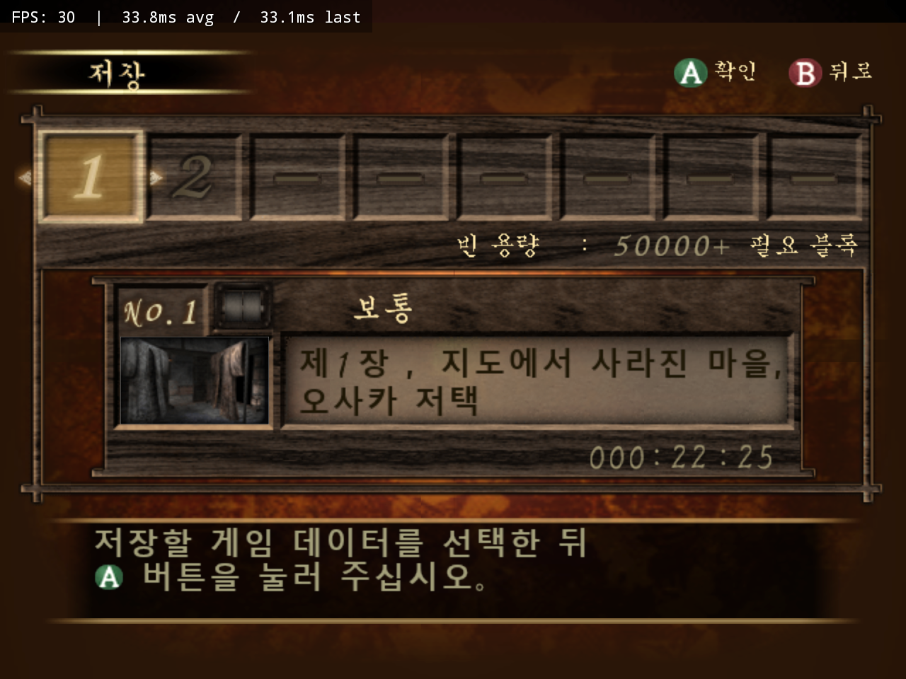
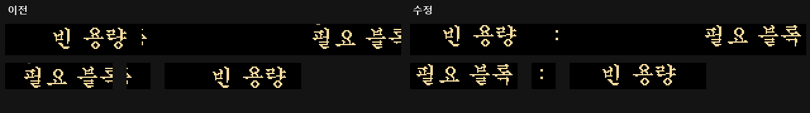
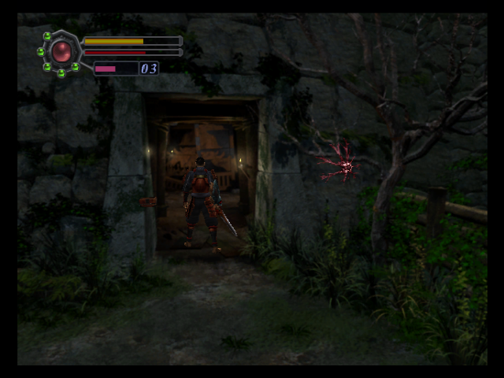
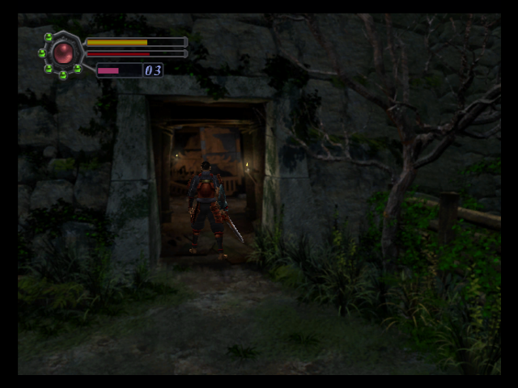
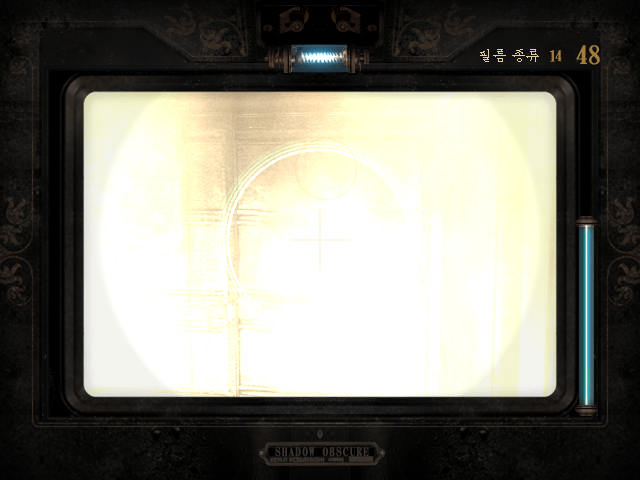
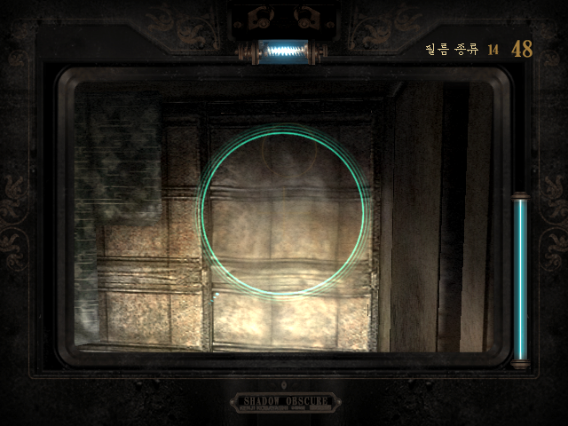

# XBOX 령 II: 붉은 나비 한국어 패치 v0.81

오리지널 Xbox **Fatal Frame II: Crimson Butterfly 일본판**의 비공식 한국어 패치입니다.
쌍둥이 자매 미오와 마유가 사라진 마을에서 사영기로 원혼과 의식의 비밀을 추적하는 공포 게임입니다.
타이틀·메뉴·대사·문서·기존 영상 자막을 한국어로 옮깁니다.

**코리아 로컬라이즈 GiKakNo**

**[v0.81 패처와 통합 에뮬 다운로드](https://github.com/OldManCraveGuitars-bit/XBOX-Fatal-Frame-II-Crimson-Butterfly-Kr/releases/tag/v0.81)** · [변경 내역](CHANGELOG.md) · [오류 제보](https://github.com/OldManCraveGuitars-bit/XBOX-Fatal-Frame-II-Crimson-Butterfly-Kr/issues)

**영상 자막과 엔딩 크레딧은 `설정 → 자막 표시 → 켜기`로 설정해야 표시됩니다.**
전편 검수가 남아 있는 공개 시험판입니다.

## v0.81 변경 내용

- 저장 화면의 **‘필요 블록’ 마지막 글자 잘림**을 수정했습니다. 실제85×21픽셀 표시 영역 안에18px 글꼴로 새로 그렸습니다.
- **‘빈 용량’ 옆의 글자 조각**은 분리된 콜론 영역에 다른 글자의 끝부분이 들어간 문제였습니다. 두 영역을 분리해 조판했습니다.
- 숫자와 프레임, 다른 텍스처는 유지합니다. v0.8 결과와 비교하면 `save_load.pk2` 한 파일만 변경됩니다.
- 수정 ISO를 연결된 기기에 적용하고 저장 화면을 다시 열어 잘림과 잔상이 사라진 것을 확인했습니다.
- 령2 백화·귀무자 배경 가림·스파이크아웃 실행 파일 로드 제한을 수정한 **hakuX Integrated QA APK와 대응 소스**를 함께 제공합니다.

수정 전 상태저장에서 바로 복귀하면 RAM에 이전 그림이 남을 수 있습니다. 저장 메뉴를 닫았다 다시 열면 새 리소스가 적용됩니다.

## 패치 적용

1. 릴리스의 `XBOX-Fatal-Frame-II-Crimson-Butterfly-Kr-v0.81-Windows-Patcher.zip`를 받아 압축을 풉니다.
2. `XBOX-Fatal-Frame-II-Crimson-Butterfly-Kr-v0.81-Patcher.exe`를 실행합니다.
3. 아래 해시와 일치하는 **패치하지 않은 일본판 원본 ISO**를 선택합니다.
4. 새 ISO 저장 경로를 지정하고 **한국어 ISO 만들기**를 누릅니다.
5. 전체 해시 검사 통과를 확인하고 생성된 ISO를 사용합니다. 게임에서 자막 표시를 켭니다.

Windows64비트용이며 Python 설치는 필요하지 않습니다. 출력 폴더에3GB 이상이 필요합니다.
원본과 기존 출력은 덮어쓰지 않습니다. v0.8 등 이미 패치한 ISO에는 다시 적용하지 마십시오.

## 함께 제공하는 Android 에뮬

`hakuX-Integrated-QA-20261123.apk`는 공식 배포가 아닌 **hakuX1.3.0 기반 비공식 통합 테스트판**입니다.
패키지 `com.rfandango.haku_x.ffiiqa`, 앱 이름 `hakuX Integrated QA`입니다.
기존 FFII QA 설치본은 업데이트되며 공식 hakuX와 기존 Spikeout QA는 별도 앱입니다.
신규 설치에서는 게임 폴더와 Vulkan 드라이버를 설정해야 합니다. 확인 환경은 Android13 / Adreno740 / Turnip Gen8 V38입니다.

- **령2:** 겹친 렌더 타깃의 일부 영역을 잘못 가져와 촬영 화면이 하얗게 누적되던 현상을 수정했습니다.
- **귀무자:** 배경 깊이 복사가 실제 GPU 깊이 이미지에 반영되지 않아 상자·붉은 물체가 벽을 뚫고 보이던 경로를 수정했습니다.
- **스파이크아웃:** XBE 구역 제한256→512. 원본398개/한글판399개를 읽던 기존 수정을 통합했습니다. 부팅 영상과 한국어 플레이어 선택 화면까지 확인했습니다.

ROM/XBE와 시스템 GPU 드라이버를 수정하는 APK가 아닙니다. [에뮬 변경·검증·라이선스](emulator/README.md)를 확인하십시오.

## 에뮬 적용 전후

같은 저장 지점·V38 드라이버·1배 해상도에서 비교한 실제 렌더링 캡처입니다.

| 귀무자 적용 전 | 귀무자 적용 후 |
| --- | --- |
|  |  |

| 령2 적용 전 | 령2 적용 후 |
| --- | --- |
|  |  |

## 한국어 패치 구성

v0.8의 원본풍 장 제목13곳과 강화한 갈색 음영, 반각 공백10px, 한글 진행 폭24px,
설정 안내·선택 칸·버튼·메모 조판, 쉼표 모양과 색 수정, 번역 보정을 유지합니다.
본문 번역4,542개, 의도된 빈 슬롯950개, 수정 이미지346개입니다.
영상/연출 자막은 등록 표71개 중 실제 구간이 있는44개 표의 **원본253구간**을 사용합니다.
엔딩3곳의 기존 마지막 대사 자막 둘째 줄에 크레딧을 표시합니다. 별도 스태프롤 끝 카드는 아닙니다.

## 해시

| 항목 | 크기 | SHA-256 |
| --- | ---: | --- |
| 일본판 원본 ISO | 7,825,162,240 | `56a2def60db6ca1d4bfe0525fef72720b87719cca9dfe85d8698afc8c47968e2` |
| v0.81 결과 XISO | 2,200,043,520 | `85e7669d6fc729f7522be0e137397f0305a44ba16d336d29b6d615a682e5a109` |
| Windows 패처 ZIP | 13,256,568 | `a902b2630c35e70e5d7c1e9cf99d232599fcb1a0baad90ebf054b48f25c5b390` |
| 통합 에뮬 APK | 7,043,451 | `354a34522c0dbb03c1abe98df209820863e99e7cc2fa3e50d49f291a5feb2819` |

결과 `default.xbe`는 원본과 바이트 단위로 동일하며 SHA-256은
`60a20fcc1cbfad2c7178208c0bfda7f62c91188a03ebe08ced06c622e3797ada`입니다.
원본 매체 값0x202를 유지하며 HDD 허용 패치는 적용하지 않습니다.
[전체 배포 목록](release-manifest.json)과 릴리스의 `SHA256SUMS.txt`로 검사할 수 있습니다.

## 검증 범위

실제 배포 EXE로 원본 ISO에서 전체 결과를 재생성하고 전체 해시를 대조했습니다.
독립 파서로4,157개 경로·크기·해시 및 원본 XBE 일치를 확인했습니다. 원본 대비99개 변경,4,058개 동일입니다.
입력·출력 보호와 손상 데이터 거부 등 패처 검사9개 및 GUI 배치 검사를 통과했습니다.
저장 문구는 수정 리소스와 실제 기기 화면을 모두 확인했습니다.

전편 수동 번역 대조·이미지 검수·음성 동기·진행·저장/불러오기 전체 검증은 남아 있습니다.
`promo_01/02/03.pss` 홍보영상3편의 추가 자막은 미구현입니다.
에뮬은 귀무자 특정 몬스터 조우, 령2 귀신 조우, 스파이크아웃 전체 플레이를 직접 검증하지 않았습니다.

[검증 JSON](verification/release-checks.json) · [검증 기록](docs/VERIFICATION.md) · [패처 빌드](docs/BUILD.md)

게임 ISO·완전한 원본 게임 파일·기기 세이브는 배포하지 않습니다.
에뮬의 실제 변경 소스와 의존성·GPL 및 구성 요소별 라이선스는 릴리스의 소스 ZIP에 제공합니다.
