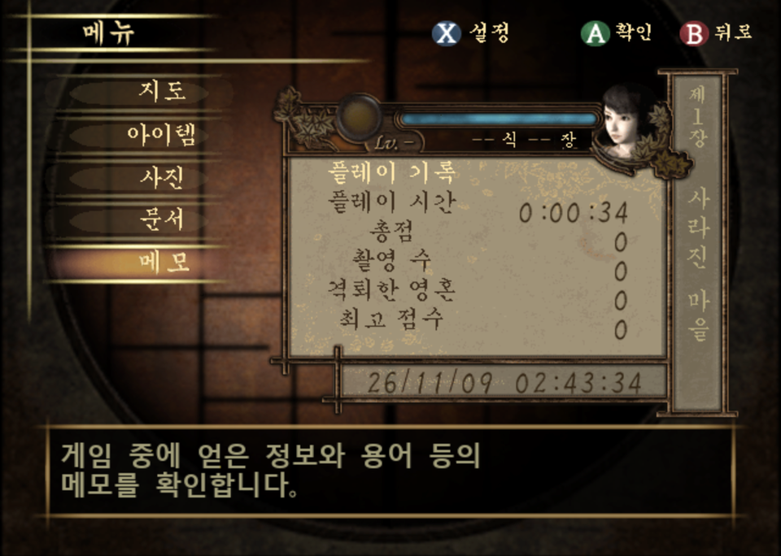
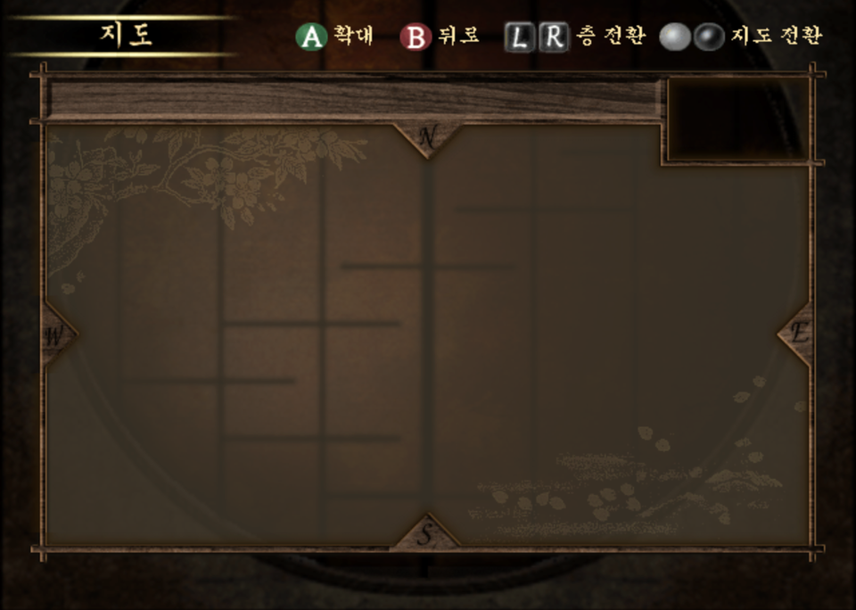
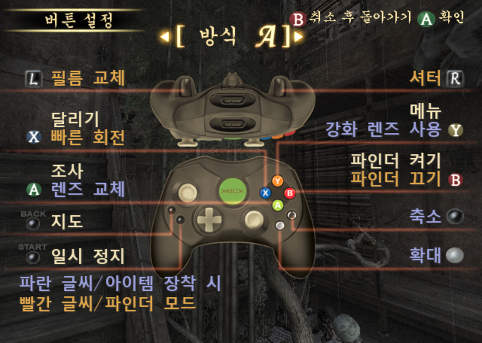
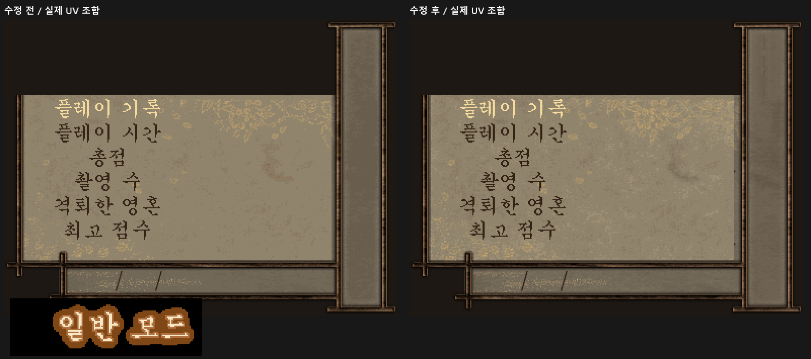

# XBOX 령 II: 붉은 나비 한국어 패치 v0.75

오리지널 Xbox **Fatal Frame II: Crimson Butterfly 일본판**의 비공식 한국어 패치입니다.
쌍둥이 자매 미오와 마유가 지도에서 사라진 마을에 들어가, 사영기로 원혼과 의식의 비밀을 추적하는 공포 게임입니다.
타이틀·메뉴·대사·문서·영상 자막을 한국어로 옮기고, 글자 잔상·잘림·버튼 안내·프레임 접합부를 정리했습니다.

**코리아 로컬라이즈 GiKakNo**

**[v0.75 Windows EXE 패처 다운로드](https://github.com/OldManCraveGuitars-bit/XBOX-Fatal-Frame-II-Crimson-Butterfly-Kr/releases/tag/v0.75)** · [수정 내역](CHANGELOG.md) · [오류 제보](https://github.com/OldManCraveGuitars-bit/XBOX-Fatal-Frame-II-Crimson-Butterfly-Kr/issues)

v0.75는 **공개 시험판**입니다. 전편 진행·저장/불러오기·전체 자막 음성 동기의 최종 검증은 남아 있습니다.

## 적용 방법

1. Releases에서 `XBOX-Fatal-Frame-II-Crimson-Butterfly-Kr-v0.75-Windows-Patcher.zip`을 받아 압축을 풉니다.
2. `XBOX-Fatal-Frame-II-Crimson-Butterfly-Kr-v0.75-Patcher.exe`를 실행합니다.
3. 아래 SHA-256과 일치하는 **패치하지 않은 일본판 원본 ISO**를 선택합니다.
4. 새 ISO의 저장 위치를 지정하고 **한국어 ISO 만들기**를 누릅니다.
5. 완료와 전체 해시 검사 통과 메시지를 확인한 뒤 생성된 ISO를 사용합니다.

Windows 64비트용이며 Python 설치는 필요하지 않습니다. 차분과 디코더는 EXE에 들어 있습니다.
출력 폴더에는 **3GB 이상**의 여유 공간이 필요합니다. 원본 ISO와 기존 출력 파일은 덮어쓰지 않습니다.
이전 한글 패치 ISO나 다른 지역판은 입력으로 사용할 수 없습니다. 대상 Title ID는 `5443000A`입니다.

## v0.75 반영 내용

- 타이틀 `령 II / 붉은 나비`, 새 게임·불러오기·설정·게임 모드·난이도 문구 한국어화.
- 번역 항목 **4,542개** 반영. 전체 슬롯 5,492개 중 나머지 950개는 의도된 빈 슬롯입니다.
- 본문 한글 **837자**를 22px로 새로 렌더링. 반각 공백은 12px로 표시합니다.
- 이미지 문구 **556곳**, 수정 이미지 **346개**의 메뉴·문서·사진·장비·조작 안내 반영.
- 영상/연출 자막 **71트랙·256구간**과 기존 음성 자막 문구 반영. 기본 자막 켜기, 기존 저장 설정과 메뉴 전환 유지.
- 엔딩 3곳에 `코리아 로컬라이즈 GiKakNo` 크레딧 추가.
- 원문·번역 1,475개 고유 쌍 재대조 후 오역·조사·문장·줄 구성 **62개 항목** 교정.
- 아이템 설명 14개를 정리하고 전체 설명을 원본 최대 줄 폭 210px·최대 5줄 범위에 맞춤.
- 새 게임 옆 잔여 선, 난이도 잔상, A 확인 위치, 메모 정렬, 식·장 크기와 잔여 글자 정리.
- 방식 선택 괄호·좌우 화살표·버튼 아이콘 복원, 설명과 선택 문구 배치 조정.
- **최근 수정:** 일반 모드의 마지막 `드`가 분리되지 않도록 한 조각 안에 재조판, `켜기/끄기` 중심 통일, 장 제목 주변 틀의 색·투명도와 필터 여백 연결.
- XBE 헤더와 섹션 해시를 정리해 아이콘/로더 호환 문제 수정.

## 스크린샷

상단 타이틀과 아래 메뉴·지도·버튼 설정은 **이전 빌드에서 확보한 실제 Android GPU 캡처**입니다.
FPS 표시가 있던 상단 48픽셀만 잘라 냈습니다. 개인 기기 사진이나 화면 내용을 합성한 캡처는 넣지 않았습니다.

| 메뉴와 메모 | 지도 안내 |
| --- | --- |
|  |  |

### 최근 UI 수정 비교

아래는 **배포 파일을 디코딩해 실제 UV 좌표로 조합한 정적 미리보기**입니다. 새 실기 캡처가 아닙니다.
왼쪽은 수정 전, 오른쪽은 수정 후 프레임이며 하단에는 한 조각으로 재조판한 일반 모드가 보입니다.

`켜기`는 원본의 ON 뒤 공백을 고려한 좌표를 바로잡아 23픽셀 왼쪽으로 이동했습니다.
진동·자막 두 줄에서 `끄기`와 같은 중심을 사용하며, 7개 선택 상태와 켜기/끄기 전환을 원본 코드로 검사했습니다.

## 지원 원본과 SHA-256

| 항목 | 크기 | SHA-256 |
| --- | ---: | --- |
| 일본판 원본 `Fatal Frame II - Crimson Butterfly (Japan).iso` | 7,825,162,240바이트 | `56a2def60db6ca1d4bfe0525fef72720b87719cca9dfe85d8698afc8c47968e2` |
| v0.75 결과 XISO | 2,200,043,520바이트 | `1621d3694be6803e6c423da38fd8b95bbb16e4b34cf5e8fdf6535c6ac731b1f1` |
| 배포 ZIP | 13,247,043바이트 | `0877829900a267feecf1c2774e2132bde5ff8518478b7a5010e2793b35a4ba0a` |
| ZIP 내부 Windows EXE | 13,464,401바이트 | `2472b3b6b36addf7601ecaad5947320c906d8b1c737a3b968ef5b45266f9fc59` |

전체 수치와 파일명은 [배포 목록](release-manifest.json), 다운로드 검사는 릴리스의 `SHA256SUMS.txt`를 확인하십시오.

## 검증 범위와 남은 확인

실제 배포 EXE로 원본 일본판 ISO에서 전체 결과 ISO를 다시 만들고 위 SHA-256과 일치함을 확인했습니다.
메시지 5,492개·포인터 표 85개, 이미지 2,446개의 무수정 왕복, 수정 리소스의 길이·형식·오프셋·밉 수,
본문 5,960개 고유 줄·3,627개 페이지, 원본 로더 읽기 크기와 ISO 내부 **4,157개 파일**을 검사했습니다.
진행 스크립트·지도·모델·음성·영상의 변경 대상 밖 데이터와 저장 식별 정보는 원본을 유지합니다.

v0.75 마지막 세 UI 수정은 **PC에서 원본 코드의 좌표 계산·재삽입 픽셀·ISO 무결성**까지 검증했습니다.
이 최종 수정본을 새로 기기에 배포하거나 실행한 것은 아닙니다.
전편 문장의 수동 대조, 획득 후 상세 화면·해금 메뉴·전편 진행·저장/불러오기·전체 음성 동기는 추가 검수가 필요합니다.
책등·설정화 등 이미지 내부의 일본어도 추가 확인 대상입니다. 모든 화면과 전편 진행의 무오류를 보장하는 완성판은 아닙니다.

- [검증 요약](verification/release-checks.json)
- [상세 검증 범위](docs/VERIFICATION.md)
- [패처 빌드 방법](docs/BUILD.md)
- [외부 구성 요소와 고지](licenses/THIRD-PARTY.md)

## 배포 구성과 제보

배포물에는 EXE 패처·사용법·체크섬·외부 구성 요소의 라이선스를 포함합니다.
게임 ISO, 완전한 원본 게임 파일, 개인 사진, 기기 식별자, 작업 캐시와 개발용 분석 자료는 포함하지 않습니다.
이 저장소는 배포용 패처 소스와 설명·스크린샷·최소 검증 요약을 관리합니다.
텍스트/이미지 제작용 편집기는 로컬 제작 프로젝트와 별도입니다.

오류 제보에는 버전, 장면·메뉴, 사용 환경, 화면 사진과 적용 후 ISO SHA-256을 함께 남겨 주세요.
